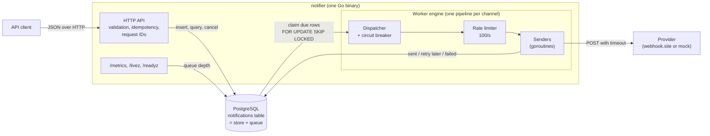

# Event-Driven Notification System

A notification service in Go that accepts SMS, email and push notifications over an HTTP API
and delivers them asynchronously through an external provider. It is built for bursts:
the API stores work and answers at once, while workers drain the queue at a fixed rate of 100
messages per second per channel, with priorities, retries, a dead-letter state, a circuit
breaker per channel, scheduled sends and Prometheus metrics.

PostgreSQL is both the source of truth and the queue, so the whole system is one Go binary and
one database.

## Contents

- [Quick start](#quick-start)
- [API examples](#api-examples)
- [Architecture](#architecture)
- [Design decisions](#design-decisions)
- [Operations](#operations): configuration, metrics, health checks, logs
- [Testing](#testing)
- [Limitations](#limitations) and [what I would do next](#what-i-would-do-next)
- [How this was built](#how-this-was-built)

## Quick start

Requirements: Docker with Compose v2. Running the tests also needs Go 1.26 or later, `make` and
`bash` (on Windows, use Git Bash or WSL).

```sh
git clone https://github.com/kaanismen/event-driven-notification-system.git
cd event-driven-notification-system
docker compose up --build
```

This starts three containers: the app on port 8080, PostgreSQL, and a **mock provider** that
accepts every message and logs it. Migrations run automatically at startup. Check it:

```sh
curl localhost:8080/health          # {"status":"ok"}
curl localhost:8080/readyz          # {"status":"ok"} once the database answers
make smoke                          # calls every endpoint and checks each response
```

**Delivering to webhook.site instead of the mock:** copy `.env.example` to `.env`, set
`PROVIDER_URL` to your own webhook.site URL and run `docker compose up -d`. Each delivered
notification then shows up on your webhook.site page. The URL acts like a password, so it lives
only in `.env`, which git ignores.

Useful commands (`make help` lists them all):

| Command | What it does |
|---------|--------------|
| `make up` / `make down` | Start the stack in the background / stop it (data is kept) |
| `make logs` | Follow the app's JSON logs |
| `make test` | All unit and integration tests (starts a throwaway Postgres) |
| `make smoke` | Exercise every endpoint against the running stack |
| `make load` | Send 10,000 notifications and watch the metrics until the queue drains |
| `make lint` / `make lint-spec` | Go linters / OpenAPI linter |

## API examples

The full contract is in [`api/openapi.yaml`](api/openapi.yaml), also served by the app at
`GET /openapi.yaml` (paste it into [editor.swagger.io](https://editor.swagger.io) to browse it).
All endpoints use JSON; every response carries an `X-Request-ID` header.

**Create a notification.** `202 Accepted` means stored and queued, not yet delivered.

```sh
curl -i localhost:8080/v1/notifications \
  -H 'Content-Type: application/json' \
  -H 'Idempotency-Key: order-1234-shipped' \
  -d '{"channel":"sms","recipient":"+905551234567","content":"Your order has shipped","priority":"high"}'
```

```json
{
  "id": "019a5b6e-7c1d-7f3a-9b2e-4d5c6a7b8c9d",
  "channel": "sms", "recipient": "+905551234567", "content": "Your order has shipped",
  "priority": "high", "status": "pending", "attempts": 0, "maxAttempts": 8,
  "nextAttemptAt": "2026-11-05T21:14:03.120456Z",
  "correlationId": "3f6c1a52-8d0e-4b7a-a1f2-9c8d7e6b5a40",
  "createdAt": "2026-11-05T21:14:03.120456Z", "updatedAt": "2026-11-05T21:14:03.120456Z"
}
```

Sending the same request again with the same `Idempotency-Key` returns the original notification
with `200` and `Idempotent-Replayed: true` instead of creating a second one; the same key with a
different body returns `409`.

**Validation errors** list every problem at once (`422`):

```sh
curl localhost:8080/v1/notifications -H 'Content-Type: application/json' \
  -d '{"channel":"sms","recipient":"12345","content":""}'
```

```json
{"error":"validation_failed","message":"the request has invalid fields","details":[
  {"field":"recipient","message":"must be an E.164 phone number, for example +905551234567"},
  {"field":"content","message":"is required and must not be blank"}]}
```

**Schedule a notification** for later (RFC 3339 with a time zone, at most 30 days ahead):

```sh
curl localhost:8080/v1/notifications -H 'Content-Type: application/json' \
  -d '{"channel":"push","recipient":"device-token-abc","content":"The sale starts now","scheduledAt":"2026-11-06T09:00:00+03:00"}'
```

**Create a batch** of up to 1000 notifications, which may mix channels. All-or-nothing: one
invalid item rejects the whole batch, and the error names it by `index`.

```sh
curl localhost:8080/v1/batches -H 'Content-Type: application/json' -d '{"notifications":[
  {"channel":"sms","recipient":"+905551234567","content":"Hello by SMS"},
  {"channel":"email","recipient":"user@example.com","content":"Hello by email","priority":"low"}]}'
# {"batchId":"019a5b6f-...","count":2,"notifications":[{"id":"...","status":"pending"},...]}
```

**Track progress:**

```sh
curl localhost:8080/v1/notifications/{id}      # one notification
curl localhost:8080/v1/batches/{batchId}       # counts per status plus every item
```

**List with filters and pagination.** Newest first; pass `nextCursor` back as `cursor` until it
is `null`. Filters: `status`, `channel`, `scheduled`, `from` (inclusive), `to` (exclusive),
`limit` (1-200, default 50). Unknown parameters are rejected rather than ignored.

```sh
curl 'localhost:8080/v1/notifications?status=failed&channel=email&from=2026-11-05T00:00:00Z&limit=20'
# {"items":[...],"nextCursor":"MjAyNi0xMS0wNVQ..."}
```

**Cancel** a notification that is still `pending` (including one waiting for a retry or its
scheduled time). Anything else returns `409` with the current status.

```sh
curl -X POST localhost:8080/v1/notifications/{id}/cancel
```

## Architecture



How a notification moves through the system:

1. **Accept.** The API validates the request and inserts one row per notification with status
   `pending` and `next_attempt_at` set to now (or to `scheduledAt`). It returns `202` at once.
2. **Claim.** For each channel, a dispatcher claims a small batch of due rows in one statement
   using `SELECT ... FOR UPDATE SKIP LOCKED`, so several workers never take the same row. The
   claim sets `processing`, a 30-second lease and `attempts + 1`. Priority is weighted
   70/20/10 (high/normal/low), so low priority slows down under load but is never starved.
3. **Send.** Each send waits for the channel's rate limiter, then POSTs `{to, channel, content}`
   to the provider with a timeout. The notification ID is sent as an `Idempotency-Key` header so
   the provider can deduplicate.
4. **Record.**
   - Any 2xx response: the row becomes `sent`.
   - A transient error (timeout, network error, 408, 429, 5xx): the row goes back to `pending`
     with a later `next_attempt_at`, using exponential backoff with full jitter and at least the
     provider's `Retry-After`.
   - A permanent error (any other 4xx), or a failure on the final attempt: the row becomes
     `failed` (the dead-letter state) and keeps the last error.

   Every write is guarded by `status = 'processing' AND attempts = <claimed attempt>`, so a worker
   whose lease expired cannot overwrite newer state.
5. **Recover.** If a worker crashes, its lease expires and another claim picks the row up again.
   On a normal shutdown, claimed but unsent rows are handed back immediately, with their attempt
   returned.

Retries and scheduled sends need no extra machinery: both are rows with a future
`next_attempt_at`, which the claim does not see until that time. If a provider fails 10 times in a
row, that channel's circuit breaker stops sending for 30 seconds, then lets one probe message test
whether it has recovered.

More detail: [docs/architecture.md](docs/architecture.md) (lifecycle diagram, data model,
package layout) and the ADRs below.

## Design decisions

Each decision is recorded as an ADR with the options considered and the trade-offs. The open
points in the brief, and the assumptions made about them, are in
[docs/ASSUMPTIONS.md](docs/ASSUMPTIONS.md). Requirements are traced to tests in
[docs/requirements-matrix.md](docs/requirements-matrix.md).

| Topic | Decision | ADR |
|-------|----------|-----|
| Queue and storage | PostgreSQL as store and queue (`SKIP LOCKED`); no broker, no dual write | [0001](docs/adr/0001-queue-and-storage.md) |
| Retries | Persisted retries, exponential backoff with full jitter (2 s base, 5 min cap), 8 attempts, transient vs permanent classification | [0002](docs/adr/0002-retry-policy.md) |
| Rate limit | Token bucket per channel (100/s, burst 1) plus a sliding one-second cap; per instance | [0003](docs/adr/0003-rate-limiter-scope.md) |
| Idempotency | Optional `Idempotency-Key`; same body replays the original, different body is `409` | [0004](docs/adr/0004-idempotency.md) |
| Crash safety | At-least-once delivery with leases and fenced updates | [0005](docs/adr/0005-crash-safety-and-delivery-semantics.md) |
| Batches | All-or-nothing, errors reported per item index | [0006](docs/adr/0006-batch-semantics.md) |
| Cancellation | Only `pending` can be cancelled; in-flight sends are not interrupted | [0007](docs/adr/0007-cancellation-semantics.md) |
| Priority | Weighted 70/20/10 instead of strict priority, to avoid starvation | [0008](docs/adr/0008-priority-scheduling.md) |
| Dependencies | Five libraries: pgx, golang-migrate, uuid, x/time/rate, Prometheus client | [0009](docs/adr/0009-dependencies.md) |
| Test database | A Compose-managed Postgres, one fresh database per test | [0010](docs/adr/0010-test-database.md) |
| Migrations | Embedded in the binary and applied at startup | [0011](docs/adr/0011-migrations-at-startup.md) |
| API semantics | `200` for replays, cursor pagination without totals, unknown fields rejected | [0012](docs/adr/0012-api-response-semantics.md) |
| Worker engine | Unbuffered handoff from dispatcher to senders, polling with fast re-claim, mock provider | [0013](docs/adr/0013-worker-engine-design.md) |
| Reliability | Failure injection, attempts returned on shutdown | [0014](docs/adr/0014-reliability-implementation.md) |
| Circuit breaker | Per channel: 10 consecutive transient failures, 30 s cool-down, one probe | [0015](docs/adr/0015-circuit-breaker.md) |
| Observability | Prometheus metrics, separate liveness and readiness, JSON logs with request IDs | [0016](docs/adr/0016-observability.md) |
| Scheduling | Optional `scheduledAt`, stored as the first `next_attempt_at` | [0017](docs/adr/0017-scheduled-notifications.md) |
| Docs and CI | Hand-written OpenAPI checked against the routes; GitHub Actions | [0018](docs/adr/0018-api-documentation-and-ci.md) |

## Operations

### Configuration

All settings are environment variables with working defaults; [`.env.example`](.env.example)
documents each one. The most important:

| Variable | Default | Meaning |
|----------|---------|---------|
| `PROVIDER_URL` | the bundled mock | Where notifications are delivered (for example a webhook.site URL) |
| `PROVIDER_TIMEOUT` | `10s` | Timeout of one provider call |
| `RATE_LIMIT_PER_SECOND` | `100` | Sends per second per channel, per instance |
| `MAX_ATTEMPTS` | `8` | Attempts before a notification is dead-lettered |
| `RETRY_BASE_DELAY` / `RETRY_MAX_DELAY` | `2s` / `5m` | Backoff curve |
| `BREAKER_FAILURE_THRESHOLD` / `BREAKER_COOLDOWN` | `10` / `30s` | Circuit breaker |
| `LEASE_DURATION` | `30s` | How long a claimed row is reserved for one worker |
| `PRIORITY_WEIGHTS` | `70,20,10` | Shares of high, normal and low priority under backlog |
| `MAX_SCHEDULE_AHEAD` | `720h` | How far ahead `scheduledAt` may be |
| `SHUTDOWN_TIMEOUT` / `SHUTDOWN_DRAIN_DELAY` | `15s` / `2s` | Graceful shutdown |
| `LOG_LEVEL` | `info` | `debug`, `info`, `warn` or `error` |

Invalid values stop the app at startup with a clear error rather than falling back silently.

### Metrics

`GET /metrics` serves Prometheus metrics:

| Metric | What it shows |
|--------|---------------|
| `notifier_queue_depth{channel,priority,status}` | Waiting work: `pending`, `scheduled` (future `scheduledAt`) and `processing`, read from the database on each scrape |
| `notifier_deliveries_total{channel,outcome}` | Attempt outcomes `sent`, `retry` and `failed`; success and failure rates come from this |
| `notifier_provider_request_duration_seconds{channel,result}` | Provider call latency |
| `notifier_delivery_latency_seconds{channel}` | End-to-end time from creation to `sent` |
| `notifier_circuit_breaker_state{channel}` | 0 closed, 1 open, 2 half-open |
| `notifier_released_total{channel,reason}` | Claimed rows handed back unsent (shutdown or breaker) |

For example, the failure rate over five minutes is
`sum(rate(notifier_deliveries_total{outcome="failed"}[5m])) / sum(rate(notifier_deliveries_total[5m]))`.

Measured with `make load` on a laptop: 10,000 notifications were accepted in about 1 second and
delivered in about 38 seconds, at about 100 per second per channel. With the mock failing 30% of
requests, 900 notifications needed 412 retries and all of them were sent.

### Health checks

- `GET /livez` (alias `/health`): the process is serving HTTP. It does not check the database,
  so a database outage does not get the app restarted in a loop.
- `GET /readyz`: the database answers within one second and the app is not shutting down. On
  SIGTERM it returns `503` for `SHUTDOWN_DRAIN_DELAY` before the listener closes, so a load
  balancer stops routing here first.

### Logs and correlation IDs

Logs are JSON on stdout. Every request gets a request ID (the caller's `X-Request-ID` if it is
safe to log, otherwise a generated one). It is stored with the notification, written on every
worker log line about it, and sent to the provider, so one ID follows a message from the API call
to delivery:

```sh
docker compose logs app | grep '"request_id":"checkout-7f3a9c"'
```

### Failure injection

The mock provider can simulate a bad provider, which is useful to watch retries, dead letters and
the circuit breaker:

```sh
MOCK_FAILURE_RATE=0.3 docker compose up -d mockprovider       # 30% of requests fail with 503
MOCK_FAILURE_RATE=1 docker compose up -d mockprovider         # provider down: the breaker opens
MOCK_FAIL_FIRST=2 MOCK_FAILURE_STATUS=429 MOCK_RETRY_AFTER=5s docker compose up -d mockprovider
```

## Testing

```sh
make test       # unit + integration tests; starts a throwaway Postgres on port 55432
make test-unit  # unit tests only, no Docker (integration tests skip)
```

The suite has about 220 tests and takes about 30 seconds. Integration tests run on a real
PostgreSQL, because the queue's correctness depends on its locking. Notable ones:

- **Queue safety:** concurrent claims never hand out the same row; a worker with an expired lease
  cannot overwrite the result of the worker that took over.
- **Rate limit:** 750 messages over three channels never exceed 100 sends in any one-second
  window per channel, retries included.
- **Failure injection** against the mock provider: flaky (retried, then sent), down (dead-lettered
  after the maximum attempts, and the breaker saves most of them), permanent `400` (failed at
  once), slow (timeout, then retry), `Retry-After` honoured, and a crashed worker's rows recovered.
- **Shutdown:** after a graceful stop, no row is left in `processing`.
- **API:** every endpoint, validation rule and error code through `httptest`; the OpenAPI spec is
  checked against the served routes.

CI ([`.github/workflows/ci.yml`](.github/workflows/ci.yml)) runs the linters, the full suite with
the race detector, the OpenAPI linter, and `docker compose up` followed by `make smoke` on every
push.

## Limitations

These are deliberate trade-offs for the assessment's scope, each discussed in an ADR or in
[ASSUMPTIONS.md](docs/ASSUMPTIONS.md):

- **At-least-once delivery.** If the app crashes after the provider accepted a message but
  before the result is saved, the message is sent again. The `Idempotency-Key` header lets a
  provider deduplicate; the window is one provider call (ADR-0005).
- **The rate limit is per instance.** One instance guarantees 100/s per channel. Running N
  instances allows N × 100/s unless the limit is divided between them or moved to shared storage
  (ADR-0003).
- **"Sent" means the provider accepted it.** There are no delivery receipts from handsets or
  inboxes (A-01).
- **No authentication or tenants.** Idempotency keys are global, and `/metrics` is open (A-15,
  A-36).
- **No expiry.** After a long outage, old messages such as one-time codes are still delivered
  (A-35). Idempotency keys are kept as long as their notification (A-16).
- **No retention.** Finished rows stay in the table. At millions per day, production would
  partition the table by creation time and drop old partitions.
- **SMS is one segment** of up to 160 characters, counted as Unicode characters; multipart SMS
  and GSM-7/UCS-2 encoding rules are out of scope (A-07).
- **Scaling out is designed, not demonstrated.** Compose runs one instance; the claim query is
  safe with many (A-21).

## What I would do next

- A shared rate limiter (a token bucket in Postgres or Redis) so several instances share 100/s.
- Table partitioning and a retention policy for finished notifications.
- Authentication with per-client idempotency keys and rate limits on intake.
- An optional `expiresAt` per notification, so stale messages are dead-lettered instead of sent.
- OpenTelemetry tracing across the API, the queue and the provider call, replacing the manual
  correlation ID.

## How this was built

This project was built with an AI coding assistant (Claude Code) in a phased workflow:

- **Human design decisions.** Before each phase, the assistant proposed the open design questions
  with options and trade-offs, and the maintainer chose. Each choice is recorded in an ADR together
  with the options that were rejected and why. Gaps in the brief were not decided silently but
  listed in [ASSUMPTIONS.md](docs/ASSUMPTIONS.md) and accepted one by one.
- **Approval gates.** The work was split into phases (foundation, API, processing engine,
  reliability, observability, delivery, plus bonus phases). Each ended with verification (format,
  vet, lint and tests, with the real output reported), a review by the maintainer, and an explicit
  approval before the next began.
- **AI-written code.** The assistant wrote the code, tests and documents, and each commit says so
  in a `Co-Authored-By` line. The maintainer reviewed each phase and is responsible for the result.

The plan and the phase list are in [docs/plan.md](docs/plan.md).
