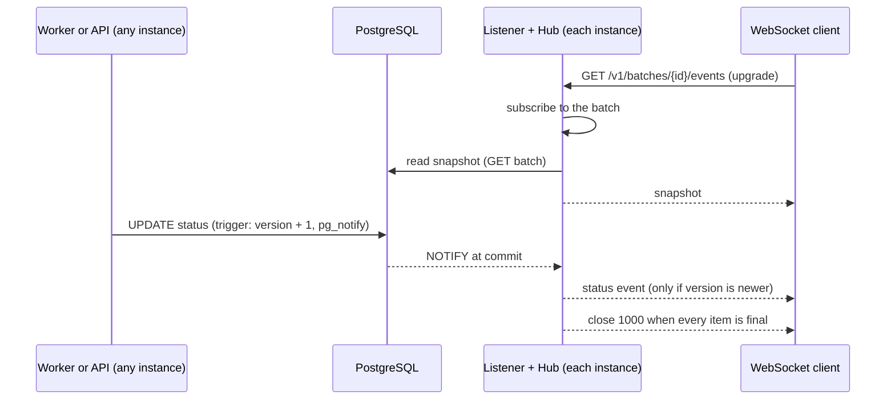

# ADR-0020: Real-time status over WebSocket

- Status: Accepted
- Date: 2026-11-06

## Context

Real-time status tracking over WebSocket is an optional bonus in the brief, approved by the
maintainer as Phase 6c. Until now clients polled the status endpoints (A-17). The goal is a
connection that shows a notification or batch moving through `pending`, `processing` and `sent`
as it happens. Status changes are written by the API (cancel) and by the workers (claim, result,
retry, release, lease recovery), possibly on different instances, so the change and the open
connection may be in different processes.

## Options and decision

### 1. Transport

- A. WebSocket with `github.com/coder/websocket`.
- B. Server-Sent Events, standard library only.
- C. WebSocket with `gorilla/websocket`.

**Decision: A** (chosen by the maintainer). The brief names WebSocket. The library is small,
maintained, supports `context.Context` and has no dependencies of its own (ADR-0009). SSE would
fit a one-way stream equally well and needs no dependency; gorilla's API predates contexts.

### 2. How status changes reach the open connections

- A. A database trigger with `NOTIFY`, received through `LISTEN` by every instance.
- B. Publishing in process from the store or the engine.
- C. An events table that each instance polls.

**Decision: A** (chosen by the maintainer). It sees every change from every code path on every
instance, because the database is where all changes meet. B misses changes made by another
instance. C adds a write per change, a cleanup job and polling delay.

### 3. What a client subscribes to

- A. One connection per resource: `GET /v1/notifications/{id}/events`, `GET /v1/batches/{id}/events`.
- B. One connection with subscribe and unsubscribe messages.
- C. A stream of all changes with filters.

**Decision: A** (chosen by the maintainer). A simple contract that fits OpenAPI and is easy to
test. B needs a small protocol of its own; C would publish everyone's messages to anyone, since
the API has no authentication.

## How it works

- **Trigger** (migration `000005`): a `BEFORE UPDATE` trigger on `notifications` increments
  `version` on every update and, when `status` or `attempts` changed, calls `pg_notify` on the
  channel `notification_status` with the ID, batch ID, status, attempts, version, the last error
  (at most 1000 characters; the payload limit is 8000 bytes) and the update time. One trigger
  covers every update path, so no code path can forget it.
- **Ordering.** NOTIFY is transactional (sent at commit, discarded on rollback) and delivered in
  commit order. Updates of one row are serialised by its row lock. So for one notification a
  higher `version` is always a later state.
- **Listener** (`internal/events`): one dedicated connection per instance, outside the pool,
  because a `LISTEN` belongs to its session. It reconnects with a backoff of 1 to 30 seconds.
- **Hub**: routes each event to the subscribers of its notification and of its batch. Publishing
  never blocks: a subscriber whose 256-event buffer is full is cut off (close `1008`). While the
  listener is down it refuses new subscriptions (`503 events_unavailable`), and losing the
  connection ends every subscription (close `1012`), because events may have been missed.
- **Handler**: it subscribes **before** reading the snapshot, so a change committed in between
  appears in the snapshot, as an event, or both, but is never lost. Events whose version is not
  newer than what the client has are dropped, so the stream only moves forward. The connection
  closes with `1000` once everything watched is final, and pings every 30 seconds.
- **Shutdown**: `Server.Shutdown` does not wait for or close hijacked connections, so the hub is
  closed through `RegisterOnShutdown` (close `1001`). The listener has its own context and stops
  last; stopping it first would wrongly tell clients that events were missed.
- **Timeouts**: the server's 15-second read and write timeouts do not cut WebSockets, because
  `net/http` clears connection deadlines when a connection is hijacked. A test guards this. Each
  write has its own 5-second timeout.

## Consequences

- No polling, and a client sees a change within milliseconds of its commit (measured: about
  50 ms from a cancel request to the event).
- Events are not stored or replayed. A client that reconnects gets a fresh snapshot instead. A
  client never ends up with a wrong final state, but it can miss intermediate steps (A-45).
- If a listening session stops reading, Postgres's notification queue (8 GB by default) fills,
  and then every transaction that calls NOTIFY fails, including status updates. Our listener
  reads continuously and hands events to the hub without blocking, so this needs a stuck process
  with an open connection. It is the main operational risk of this design.
- NOTIFY takes a short global lock at commit. At our rate (up to about 300 sends per second, two
  or three events each) this is negligible; at much higher write rates an events table or a
  message broker would replace it.
- One extra database connection per instance, outside `DB_MAX_CONNS`.
- A batch snapshot can be several MB for long emails; clients must raise their message size
  limit (the spec says so; `cmd/watch` uses 32 MiB).
- `cmd/watch` is a small client for demos, because curl cannot speak WebSocket.
