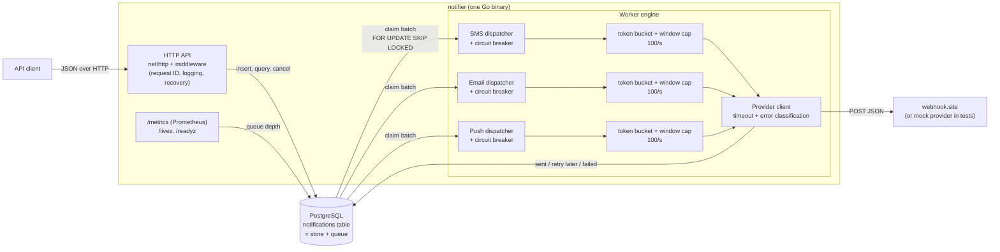
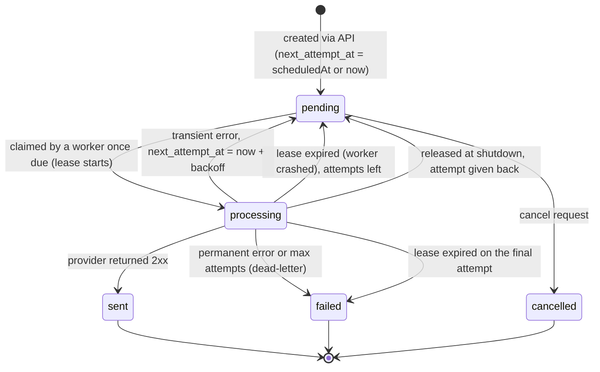

# Architecture

Status: **Accepted** (2026-11-05). It follows the options chosen in ADR-0001 to ADR-0008.

## Overview

One Go binary runs two parts: an HTTP API and a worker engine. PostgreSQL is both the source of
truth and the queue: each notification is one row, and its status columns double as the queue state.
Workers claim rows with `SELECT ... FOR UPDATE SKIP LOCKED`, send them through a per-channel rate
limiter to the provider, and write the result back to the same row.



## Notification lifecycle



## Request flow (create)

1. The middleware reads `X-Request-ID` or generates one, puts it in the request `context`, adds it
   to every log line and echoes it in the response.
2. The handler decodes JSON with a body size limit and validates the content (required fields,
   recipient format, per-channel length limit, and an optional `scheduledAt` that is at most 1
   minute in the past and at most `MAX_SCHEDULE_AHEAD` ahead). Invalid input returns 422 with
   field errors.
3. If an `Idempotency-Key` header is present and already known, the handler returns the original
   resource (or 409 if the body differs). See ADR-0004.
4. One transaction inserts the row(s) with `status = pending` and `next_attempt_at = now()`, or the
   requested `scheduled_at` (ADR-0017), plus the correlation ID so the worker can log under the
   same ID. A scheduled row is not seen by the claim before its time.
5. The API returns `202 Accepted` with the notification (or batch) ID. Delivery happens later.

## Worker flow (deliver)

1. For each channel, one dispatcher goroutine first dead-letters rows whose lease expired on their
   final attempt. If the channel's circuit breaker is open (ADR-0015) it claims nothing until the
   cool-down is over, then a single probe row. Otherwise it claims a small batch (ADR-0013): first rows whose lease expired and that have
   attempts left, then due `pending` rows per priority level up to its weighted share, then any due
   rows for unused share (ADR-0008). Each claim is one `FOR UPDATE SKIP LOCKED` statement that sets
   `status = processing`, `locked_until = now() + lease` and `attempts = attempts + 1`. Rows go to a
   pool of sender goroutines over an unbuffered Go channel, so nothing is claimed far ahead.
2. For each claimed row, a sender waits for the channel's token bucket and its one-second window cap
   (ADR-0003 and its amendment), then POSTs `{to, channel, content}` to the provider with a timeout. The notification ID goes in an
   `Idempotency-Key` header and the correlation ID in `X-Request-ID`.
3. The result is written back, guarded by `WHERE id = $1 AND status = 'processing' AND attempts = $2`.
   If the lease expired and another worker took the row, this update matches nothing and is logged
   instead of overwriting newer state (ADR-0005).
   - 2xx: `sent`, store `provider_message_id`.
   - Transient error and attempts left: back to `pending` with `next_attempt_at = now() + backoff with jitter`,
     never sooner than the provider's `Retry-After` (ADR-0002, A-30). The retry comes back through
     the normal claim, so it passes the same rate limiter as a first attempt.
   - Permanent error or no attempts left: `failed` with `last_error` (the dead-letter state).
4. When the queue is empty, the dispatcher sleeps for a short poll interval. When a claim returns a
   full batch, it claims again immediately.
5. On shutdown (SIGTERM), dispatchers stop claiming, in-flight sends finish within a deadline, and
   claimed rows that were not sent are released back to `pending` with their attempt given back
   (ADR-0014).

## Data model (indicative, finalized in Phases 1-2)

`notifications`: `id` (UUID), `batch_id` (nullable), `channel`, `recipient`, `content`, `priority`,
`status`, `attempts`, `max_attempts`, `next_attempt_at`, `locked_until`, `last_error`,
`provider_message_id`, `correlation_id`, `created_at`, `updated_at`, `sent_at`, `scheduled_at`
(nullable, migration `000003`).

`idempotency_keys`: `key` (primary key), `request_hash`, `resource_type`, `resource_id`, `created_at`.

Main index: a partial index on `(channel, priority, next_attempt_at) WHERE status = 'pending'`, so
the claim query only touches due rows and stays fast however many finished rows exist.
A second partial index on `(channel, locked_until) WHERE status = 'processing'` serves the
lease-recovery half of the claim (rows whose worker crashed). Migration `000001` is the source of truth.

## Package layout

```
cmd/notifier/          main: wiring, config, signal handling, graceful shutdown
cmd/mockprovider/      the mock provider as a server, with injectable failures
internal/config/       environment variables to a typed Config struct
internal/logging/      JSON logger; request ID carried through context.Context
internal/notification/ domain types, validation, status transitions (no I/O)
internal/store/        PostgreSQL access: CRUD, claim, complete, queue depth
internal/httpapi/      handlers, middleware, health checks, JSON helpers
internal/worker/       dispatchers, rate limiting, retry policy, circuit breaker
internal/metrics/      Prometheus registry and the service's metrics (ADR-0016)
internal/provider/     HTTP client for the provider + mock provider server
migrations/            versioned SQL migrations (golang-migrate), embedded in the binary
internal/testdb/       test helper: one fresh database per integration test
```

Interfaces exist only at real boundaries: the store (so handlers can be tested with a fake), the
provider client (so workers can be tested with a fake) and the clock (so backoff and leases are
testable).

## Observability (ADR-0016)

- `GET /metrics`: Prometheus metrics. Queue depth per channel, priority and status (read from the
  database per scrape), delivery outcomes, provider call duration, end-to-end latency, circuit
  breaker state, released rows, plus Go runtime and process metrics.
- `GET /livez` (alias `/health`): the process serves HTTP. `GET /readyz`: the database answers and
  the process is not shutting down; on SIGTERM it fails `SHUTDOWN_DRAIN_DELAY` before the
  listener closes.
- JSON logs with the request ID on every line, from the API request through the worker to the
  provider's `X-Request-ID`. Access logs name the matched route; probe requests log at DEBUG.
